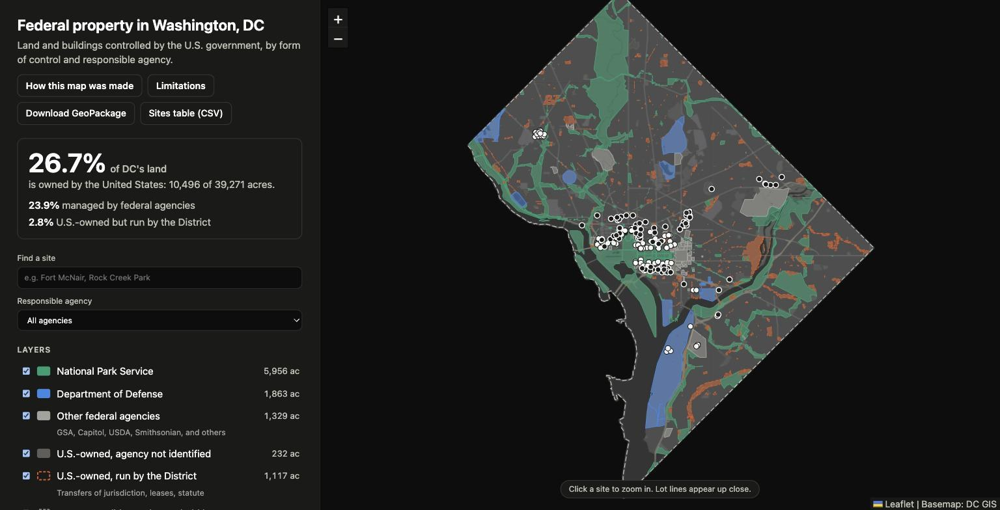

# Federal property in Washington, DC

A public dataset and web map of the land and buildings the U.S. government controls in Washington, DC, classified by form of control and responsible agency.

**October 2026, built in one week** · Python, geopandas, Leaflet, AWS

**Live tool:** [Federal property in Washington, DC](https://dc-federal-property-map.dev.cmoser.ofra.io/), including a public "How this map was made" page and downloadable data.

## The problem

"How much of DC does the federal government own?" has no single answer, because ownership, management, and jurisdiction are different things. Published estimates disagree because they define these differently. The map separates them and shows its work.

## My role

Sole developer. 21 commits.

## Engineering highlights

- **Data fusion from public layers.** About twenty public sources, including DC's property and boundary layers, National Park Service tracts, Defense installation boundaries, the GSA building inventory, and the Federal Real Property Profile.
- **Four facts, not one flag.** Each assessor lot is classified separately on title holder, federal interest, controller, and responsible agency, using ordered evidence rules that are published on the map's methodology page.
- **Geometry cleanup.** Overlapping legacy parcels are made non-overlapping by source priority, air-rights lots are excluded, and acreage counts land only.
- **Named sites.** Lots are grouped into about 1,100 named sites, with manual overrides allowed only when they cite a source.
- **Reproducibility.** Every source snapshot is committed with its URL, query, record count, and checksum, and the whole dataset rebuilds offline with one command.
- **Structured QA.** Verification and validation rounds checked accounting identities (acreage reconciles across sites, agencies, and categories), had independent graders review random samples, adjudicated disagreements, and compared results with external acreage benchmarks. Findings drove fixes before publication.
- **Outputs.** GeoPackage, GeoJSON, a CSV sites table, a single-file HTML map, and a large-format vector poster.
- **Hosting.** A small FastAPI app on ECS Fargate behind a load balancer serves the map, deployed with two CloudFormation stacks (build and app) and a deploy script with a dry-run mode.

## Scale of my work

| Measure | Value |
|---|---|
| Commits | 21, sole author |
| Python files | 29 |
| Lines of Python | about 5,700 |
| Public sources fused | about 20 |

## Stack

Python 3.12, `uv`, geopandas, pyogrio, shapely, pyproj, pandas, Leaflet, matplotlib, FastAPI, Docker, AWS CloudFormation, CodeBuild, ECR, ECS Fargate, Application Load Balancer, Route 53, pytest.
